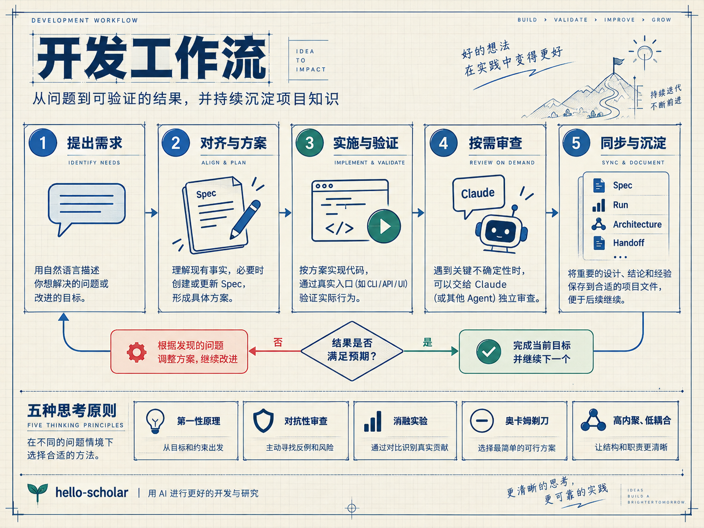
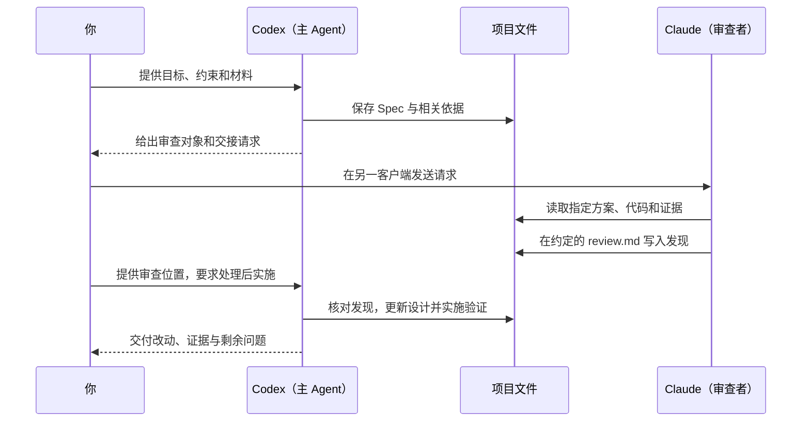
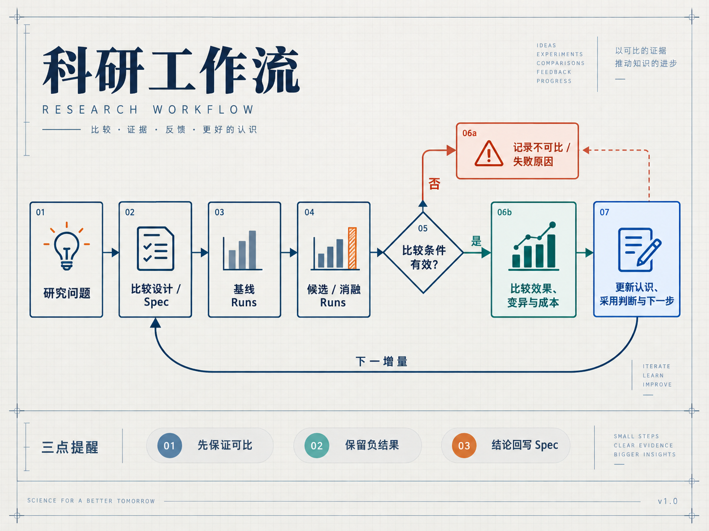

# hello-scholar

**让开发方案、科研实验和协作上下文留在项目中。**

hello-scholar 是面向科研与开发的 Agent 工作流，提供[通用工程规则](AGENTS-zh.md)、十个独立 Skills 和文档 CLI。你用自然语言描述目标，Codex、Claude Code 等 Agent 根据任务选择方法，把具体方案、实际执行和关键判断保存为可接续的项目文件。

它适合需要持续迭代的开发项目、需要比较与复现的科研实验，以及经常切换会话或协作 Agent 的工作。日常小修改直接完成；需要长期保留的设计和证据按各自用途保存。

[快速开始](#快速开始) · [开发工作流](#开发工作流) · [五种思考原则](#五种思考原则) · [跨 Agent 协作](#跨-agent-协作) · [科研工作流](#科研工作流) · [十个 Skills](#十个-skills) · [项目文件](#项目文件) · [安装与维护](#安装与维护)

## 快速开始

准备 Node.js、npm，以及 Codex 或 Claude Code。通过 Git 获取源码时还需要 Git。

### 1. 获取并安装 CLI

```bash
git clone https://github.com/Tx1207/hello-scholar.git
cd hello-scholar
npm install -g .
hello-scholar help
```

已有源码或解压包时，进入该目录执行 `npm install -g .` 即可。也可以直接通过 `node /path/to/hello-scholar/bin/hello-scholar.js` 调用，下文的 `hello-scholar` 命令均可替换为这个入口。

### 2. 在目标项目中安装规则和 Skills

进入你要开发的项目，按所用工具执行对应命令；同一项目使用两种工具时，两条都执行：

```bash
cd /path/to/your-project
hello-scholar install codex
hello-scholar install claude
```

Git 项目以仓库根目录为安装目标，其他目录使用当前目录。安装默认包含**全部 10 个 Skills**。

| 客户端 | 项目规则 | Skill 目录 |
| --- | --- | --- |
| Codex | `AGENTS.md` | `.agents/skills/` |
| Claude Code | `CLAUDE.md` | `.claude/skills/` |

两种安装使用同一份通用规则。安装器保留管理块之外的项目内容，安装本身不创建 Spec 或实验记录。安装器还会在项目的 `.gitignore` 中维护一个管理块，忽略 `/artifacts/` 和 `/runs/*/logs/`，让 Run Record 可以进 Git，而 checkpoint 和原始日志不会被误提交；两个客户端共用这一块，最后一个卸载时才移除。

默认 `link` 模式需要保留 CLI 来源及路径。想让项目拥有独立的 Skill 副本时，加上 `--mode copy`：

```bash
hello-scholar install codex --mode copy
hello-scholar install claude --mode copy
```

### 3. 在该项目中开始一个任务

打开 Codex 或 Claude Code，描述目标、约束、已有材料，以及本轮希望做到哪一步。例如：

```text
给检索接口增加批量查询能力，保留现有单条查询接口。
先读取相关代码，明确顺序和逐项错误处理的取舍，形成可审阅方案并保存到 Spec。
本轮先做设计；概要中写清改哪里、怎样改、必要步骤和验证办法。
```

后续可以直接说：

```text
按这份 Spec 继续实施，完成相关验证，把实际结果和剩余问题更新回 Spec。
```

你可以直接描述需求，也可以点名使用某个 Skill。主 Agent 负责持续推进整体任务，按实际缺口选择独立能力。

## 开发工作流

一次任务从目标和现有事实出发。局部修复通常直接实现和验证；持续研发先形成具体方案，并把需要复用的决定保存在 Spec 中。



各环节按任务需要选用，审查可以发生在设计或实施阶段；验证发现问题时，回到相关方案或改动继续处理。

### 对齐需求，保存可审阅方案

Agent 先从现有代码、文档和材料中查明事实，再与你讨论会改变结果的选择。需要深入质询时使用 `grilling`；剩余答案不会改变实现方向或验收时，就可以继续。

持续研发形成可审阅方案后，主 Agent 保存到已有文档归属，或通过 `manage-specs` 创建 Draft Spec。方案写清目标、具体改法、必要步骤、关键取舍和判断标准；尚未解决的重要问题也一并保存。

独立质询、临时解释和明确要求不保存的讨论，可以在聊天中完成。普通小改动通常不新建 Spec，但影响已有设计时仍需更新。

### 实施、验证和审查

明确要求实施后，主 Agent 自行安排步骤、修改代码并完成相关验证。较大任务按可以独立判断结果的范围拆分；只有前置条件和文件归属清楚的部分才并行推进。

验收依据来自用户目标、业务规则和外部契约。关键路径从真实 CLI、API 或 UI 入口验证，并检查最终状态或日志；入口不可用时说明较窄检查能证明什么。已有相关检查通过后，按新修改或实际疑点决定是否继续验证。

需要独立视角时使用 `review` 检查方案、实现或证据；需要清理多余机制时使用 `ponytail`。发现统一交回主 Agent 核对、处理和验证，具体的跨客户端做法见[跨 Agent 协作](#跨-agent-协作)。

### 交付并保持项目事实一致

交付说明实际变化、用户可见行为、验证结果与剩余问题。范围、接口或判断标准变化时同步 Spec；新证据改变认识时更新当前结论，并保留过去运行的真实条件。已实现且已采用的结构变化再写入 Architecture。

## 五种思考原则

五种原则帮助 Agent 判断方向、证据、复杂性和职责。遇到相应问题时选用，已经足以支持下一步行动就继续工作。

| 原则 | 它帮助回答的问题 | 在工作中的做法 |
| --- | --- | --- |
| **第一性原理** | 真正要解决什么？哪些限制必须成立？ | 从目标、事实和约束重新推导选择，核实沿用的假设。例如接口变慢时先找瓶颈，再决定是否引入缓存。 |
| **对抗性审查** | 什么情况足以使当前方案失败？ | 寻找具体反例，核对触发条件、后果和证据；重点检查核心假设，而不是堆积抽象风险。 |
| **消融实验** | 收益来自哪个机制？机制之间是否有相互作用？ | 设计可比的对照或组合，观察贡献、变异与成本；按问题选择实验条件，不强制所有研究使用单因素顺序。 |
| **奥卡姆剃刀** | 哪些复杂性是当前需求所必需的？ | 选择满足契约的最小完整方案；沿调用关系判断每个配置、包装或回退保护了什么，再决定精简。 |
| **高内聚、低耦合** | 谁拥有状态和决定？依赖是否符合职责？ | 为行为和文件明确归属，调整实际存在问题的边界；相似实现仍可能承载不同的研究或业务语义。 |

可以直接这样提出要求：

```text
从第一性原理检查这个问题，先区分真实约束和沿用的假设。
对推荐方案做对抗性审查，再按奥卡姆剃刀检查每个机制的必要性。
把决定和理由写清楚；只有需要验证机制贡献时，再设计对应的消融比较。
```

方法的价值体现在具体选择中。Skills 提供各领域的判断依据和适用条件，正文按读者需要解释关键理由。

## 跨 Agent 协作

Codex、Claude Code 以及能够读取项目文件的其他 Agent，可以围绕同一份设计和证据接续工作。**主 Agent 负责整体任务与整合，审查者提供独立发现，执行者负责约定范围。** 这些角色可以互换，也可以由同一工具的不同会话承担。

CLI 当前提供 Codex 和 Claude Code 的安装入口。其他客户端可读取共享的 Markdown、代码和 Git，规则及 Skill 的加载方式按该客户端配置。

### 独立审查：Codex 设计，Claude 审查，再交回主 Agent

以下示例通过手动切换客户端即可完成。在同一项目分别安装两套支持后，让两个客户端打开同一项目；不同机器或 checkout 之间先同步约定的代码版本和审查材料。



**第一步：在主 Agent 中说：**

```text
我要把当前方案交给 Claude 审阅，帮我准备交接，并让审查者把结果写入 Spec 同目录的 review.md。
```

主 Agent 根据当前项目补齐实际路径、Revision、代码范围、相关证据和审查重点，并明确审查者只追加发现，不修改方案、代码或启动实验。

**第二步：把生成的交接请求粘贴到 Claude Code。** 不必重新填写路径或复述背景；有特别关注的问题，再补充一句即可。

**第三步：审查完成后，回到主 Agent 说：**

```text
读取这轮 review.md，核对并处理发现，说明未采纳项的理由，再按更新后的方案实施和验证。
```

本轮只做设计时，把最后一句换成“更新方案，暂不实施”。

**修改已有 Spec 也适用。** 可以说“我要把这次对原 Spec 的修改交给 Claude 审阅”。交接应提供可恢复的旧版基线和本次差异，说明哪些决定拟改变、哪些约束仍须保持；旧版无法恢复时，明确审查无法覆盖哪些变更。审查期间保持输入稳定，区分审查新方案是否合理与检查代码是否实现该方案。

代码或证据变化后，旧审查只覆盖原状态；即使 Spec Revision 未变，也需核对受影响的判断。多个 Agent 意见一致不能代替实验或验收证据。

如果当前客户端已有可用且获授权的跨模型调用能力，可以让主 Agent 直接发起审查；否则使用上述文件交接。hello-scholar CLI 负责安装与文档管理，模型调用由所用客户端提供。

### 换会话或换 Agent 继续工作

用 `handoff` 保存现有文件和 Git 无法恢复的信息，例如尚未解决的选择、正在运行的任务、具体阻塞和下一步入口。

```text
准备交给另一个 Agent 继续。
请写 Handoff，引用当前 Spec、代码状态和相关 Run，补充尚未解决的问题与下一步；
已有文件能够恢复的内容直接引用，不重复整段聊天。
```

新 Agent 从 Handoff 和对应项目文件核实当前状态，再继续剩余任务。已有运行按实际记录查询或维护，避免为了恢复上下文重新执行。

### 并行实现不同部分

并行适合前置条件明确、可以独立完成和验证的工作。委派时说明目标、输入、可修改文件和返回证据；同一文件同一时刻由一个负责人修改。使用客户端已有的 subagent 能力委派独立任务；需要隔离代码改动时使用独立 Git worktree。最后由主 Agent 集成并验证组合后的行为。

## 科研工作流

**一个科研增量减少一个会影响下一步选择的关键不确定性。** 它可以包含多次 Run，结果为负也可能完成研究任务。

以判断一个候选方法是否值得采用为例：



基线与候选不要求串行运行。比较有效时分析效果、变异与成本；不可比或执行失败时记录原因，再更新判断。两类结果都回写 Spec，是否开始下一增量取决于目标、预算与停止条件。

### 先设计能回答问题的比较

运行前明确本轮问题、对照与干预、数据与评价条件、重复安排、解释标准、资源预算和停止条件。探索阶段可以先明确未知，再逐步形成假设；复用历史基线前确认条件可比。

```text
我们想判断辅助损失是否带来可重复的准确率收益，允许训练耗时增加不超过 10%。
先核对现有基线是否可比，在 Spec 中设计配对比较、结果解释和停止条件。
本轮只做设计，不启动训练；预算和重复次数中的关键未决项请明确列出。
```

### 按证据价值保留 Run

| 运行或操作 | 保存方式 |
| --- | --- |
| 用于研究结论、复现、恢复或重要资源决策的执行 | 保留独立 Run Record，记录实际命令、输入、环境、输出和结果。 |
| 小而快速，但会改变研究选择的正式比较 | 同样保留 Run，速度和成本不决定证据价值。 |
| 普通 import、连接、配置、启动 smoke 和重复轮询 | 留在任务验证、已有日志或对应实验的 planned Record 中，不单独创建科研 Run。 |
| 已有 Run 的新状态或结果 | 更新同一 Record，保留该次执行的真实条件。 |
| 汇总已有材料、撰写研究笔记或周报 | 引用来源，生成文字本身不创建 Run。 |

**开跑前先找可复用的 Run。** Agent 先查 `runs/INDEX.md` 和已有 Record：能直接引用的结果不重跑，只缺部分条件时只补跑缺失部分，变化用已有入口的参数或配置表达，不复制脚本改常量。Record 的 `entry` 写执行入口，`derived_from` 写所复用或修改的 Run，`runs/INDEX.md` 会显示这两列，下次就能按入口找到相似实验。

昂贵、远程、GPU 或临时产物本身不足以说明值得建 Record。正式运行由 `record-experiment` 保存事实，主 Agent 负责总体设计与跨 Run 判断。补记已有实验依据真实材料完成，不为补文档重跑。

启动准备可以在同一 planned Run 中续写：错误摘要和修复写入 `record.md`，各次原始日志分别保存为 `runs/<run-id>/logs/startup-NN.*`，或引用已有位置。正式实验开始后继续维护该记录；正式执行失败后，获得授权再另建 Run，`derived_from` 指向失败的那次，并保留原失败证据。

### 从结果形成认识，再决定下一步

核对运行是否完成、比较是否有效，以及结果能支持什么。完整保留相关比较、变异、有意义的失败和负结果；不要只报告最好的一次。

有效负结果可以回答研究问题，是否采用方法仍看对应的效果和成本条件。OOM 可以说明当前资源配置不可行，不能据此判定算法假设错误。下一轮围绕仍会改变选择的未知展开，并遵守目标、预算与停止条件。

需要整理阶段结果时，可以用 `synthesize`：

```text
综合这些 Run 和研究笔记，说明当前问题取得了什么进展，
哪些结果可比较、哪些解释得到支持，以及什么仍未确定。
提炼有依据、能指导后续实验的经验，再整理成可直接使用的飞书周报正文。
```

研究笔记保留认识变化、反例和方法；周报突出对目标有意义的发现、决定和后续安排。两者保留相同的事实含义，区分已经作出的决定与当前建议。向飞书发送内容需另有明确的发送请求。

### 发布开源代码

研究代码往往和适合公开的代码差别很大。`release-code` 把公开版本当作从研究代码单向导出的结果，而不是另一套并行维护的代码：从论文结论对应的 Run 出发，只带走真正执行过的最小代码路径，在没有开发历史的 orphan 分支上组装，默认推送到单独的公开仓库。验收标准是公开代码在全新环境中复现论文报告的结果（或用户选定的部分 Run），而不是复现项目里所有的 Run Record；Run Record 提供每条结论的确切条件。

```text
用 release-code 为论文表 2 和表 3 准备开源版本。
先建发布 Spec，把每条结论对应到 Run 和容差，再组装、检查泄漏、复现评测结果。
做完停在本地，告诉我复现情况和推送命令。
```

## 十个 Skills

全部 10 个 Skills 随安装提供，可以独立使用。主 Agent 负责整体目标、通用设计、普通实现、科研设计、验证与事实同步；专项 Skill 提供对应工作的判断方法。

| Skill | 何时使用 | 交付什么 |
| --- | --- | --- |
| [grilling](skills/grilling/SKILL.zh_CN.md) | 目标、约束或取舍需要互动澄清，或开工前想把请求挖深 | 已明确的决定、理由和关键未决项；或一份更深入、可直接粘贴的改写请求。可用于项目之外的想法。 |
| [manage-specs](skills/manage-specs/SKILL.zh_CN.md) | 设计需要长期保存、修订或替代 | 具体方案、约束、判断标准和证据清楚连接的 Spec。 |
| [record-experiment](skills/record-experiment/SKILL.zh_CN.md) | 一次执行需要作为证据保留，或维护已有运行 | 真实的 Run Record 及有边界的单次解释。 |
| [review](skills/review/SKILL.zh_CN.md) | 需要独立检查方案、代码或研究证据 | 有实质影响的发现、依据、触发条件和处理方向。 |
| [ponytail](skills/ponytail/SKILL.zh_CN.md) | 指定改动或模块出现非必要复杂性 | 实际简化、保留行为的依据及相关验证。 |
| [synthesize](skills/synthesize/SKILL.zh_CN.md) | 整理思路、实验结果、研究笔记或周报 | 有证据支撑的认识、影响和有条件的可复用经验。 |
| [remote-run](skills/remote-run/SKILL.zh_CN.md) | AI 工具在本地，代码要在通过 SSH 访问的 GPU 服务器（例如离线服务器）上运行 | 同步、前后台运行、日志、停止和拉回结果的脚本，写入项目的远程执行规则，以及真实服务器上的验收结果。 |
| [release-code](skills/release-code/SKILL.zh_CN.md) | 把研究代码整理成可复现的开源版本，或在研究代码变化后更新它 | 在独立分支上组装好的公开版本、泄漏检查结果，以及逐条对照论文报告结果的复现结论；推送需另行授权。 |
| [docs-maintenance](skills/docs-maintenance/SKILL.zh_CN.md) | 检查文档、同步导航或维护已采用架构 | 一致的项目说明、检查结果或生成索引。 |
| [handoff](skills/handoff/SKILL.zh_CN.md) | 换会话、换 Agent 或交接未完成任务 | 能从具体入口继续工作的交接文件。 |

例如，清理代码可以直接说：

```text
用 ponytail 精简这个分支新增的配置和包装层，保留现有 API 和实验对照开关。
完成相关验证，说明实际删去或合并了什么，以及为什么仍满足需要。
```

## 项目文件

项目文件保存可被不同 Agent 读取的设计、事实与判断。先沿用已有文档归属；没有既有约定时，使用以下位置。

新项目按生命周期和是否进 Git 安排目录，已有项目沿用原结构，并把实际布局写进 Architecture 第 6 节：

```text
project/
├── src/<pkg>/            # 可复用代码
├── scripts/              # 少量带参数的入口
├── configs/              # 实验变体用配置表达，不复制脚本
├── tests/
├── hello-scholar/        # Spec、Architecture、Handoff（进 Git）
├── runs/<run-id>/        # record.md、生效配置、小结果汇总（进 Git）
│   └── logs/             #   原始日志，含启动检查 startup-NN（不进 Git）
├── data/                 # 数据集（不进 Git，可软链接到数据盘）
├── artifacts/<run-id>/   # checkpoint、预测结果等大产物（不进 Git，可软链接）
└── tmp/                  # 临时文件（不进 Git）
```

Run 目录只放小文件；checkpoint 放在同名的 `artifacts/<run-id>/` 下，Record 写实际路径，派生 Run 引用上游路径而不复制。

| 材料 | 负责保存的内容 | 默认位置 |
| --- | --- | --- |
| Spec | 当前目标、具体方案、研究设计、判断标准、验收证据与下一步 | `hello-scholar/specs/<topic>/SPEC-NNN-<name>/spec.md` |
| Run Record | 一次实际执行的条件、日志、结果和单次结论 | `runs/<run-id>/record.md` |
| 审查记录 | 某一版本的独立发现与处理，按轮次保留 | Spec 同目录的 `review.md`，按需创建 |
| Architecture | 当前已经实现并采用的系统结构、职责和契约 | `hello-scholar/architecture.md` |
| Handoff | 现有材料无法恢复、但下一 Agent 需要的信息 | `hello-scholar/handoffs/` |
| Index | 定位 Spec 或 Run 的生成导航 | 对应目录中的 `INDEX.md` |

Spec 可以从 Draft 开始，明确要求按当前方案实施后，在关键未决选择解决时进入 accepted；验收要求有有效证据后才标记 completed。方案语义变化递增 Revision，仅补充证据、格式或生命周期状态不递增。

研究设计和跨 Run 判断归 Spec，每次执行事实归 Record。总结引用来源并解释其关系；新的认识不改写过去实验条件。Architecture 只更新已核实、已采用的结构性事实，普通提交或一次测试本身不要求改写它。

检查文档与更新导航：

```bash
hello-scholar docs check
hello-scholar docs sync
```

`check` 只读；`sync` 更新生成索引，不改写源 Spec 或 Record。

### 交付内容怎样组织

方案先说明选择、具体改法、步骤和取舍；结果先说明实际变化及证据。Run 把当前发现与解释放在前面，再展开复现细节；运行中如实标记尚无结果。

正文保留理解结论所需的理由、数值、条件和不确定性。每段推进必要的理解，后文承接已有证据，避免在结论、下一步和经验中反复重述。短解释用段落，比较用表格，流程和关系用图；是否增加交互由理解需要决定。

## 安装与维护

### link 与 copy

| 模式 | 适合的情况 | 更新与修改的影响 |
| --- | --- | --- |
| `link`，默认 | 多个项目共用一套 Skills | Skill 链接到 CLI 来源；来源及路径需保留。从项目链接修改 Skill 也会修改来源。 |
| `copy` | 项目需要独立保存或定制 Skills | 项目拥有副本，修改不影响来源；副本中的安装标记用于识别归属和本地修改。 |

升级时先更新 CLI 来源，再在目标项目重复安装。使用 `copy` 的项目继续显式带上 `--mode copy`；省略该参数始终采用 `link`。规则正文是写入项目的文本，两种模式都需要重装才能更新规则。

规则块与当前模板一致时直接重装；不一致时先处理替换确认。修改过的 Skill 副本、未知同名目录和其他来源链接会在写入前被识别并报告。安装器在确认归属和替换范围后操作，保留管理块之外的用户内容。

旧安装中的 `converge-to-spec` 由 `review` 承接，`takeoff`、`landing`、`crash-audit` 已退出当前集合。升级只自动清理归属明确、未被修改的退休安装，保留项目 Spec、Run 和历史材料。

### 项目偏好

在项目的 `AGENTS.md` 或 `CLAUDE.md` 管理块之外记录长期偏好，例如：

```markdown
## 项目偏好

- 文档和回答使用中文，技术标识保留原文。
- 方案先说明具体改法、步骤和取舍，结果引用相关验证证据。
- 验证使用项目已有命令；新增依赖前检查现有代码和标准库。
```

同时使用多个客户端时，让它们采用一致的项目偏好。临时输出要求直接写在当前请求中即可。

### 命令速查

| 命令 | 用途 |
| --- | --- |
| `hello-scholar help` | 查看帮助。 |
| `hello-scholar install codex` | 安装 Codex 项目支持。 |
| `hello-scholar install claude` | 安装 Claude Code 项目支持。 |
| `hello-scholar install codex --mode copy` | 使用独立副本；Claude 同样支持该参数。 |
| `hello-scholar docs check` | 只读检查文档。 |
| `hello-scholar docs sync` | 生成或更新文档导航。 |
| `hello-scholar uninstall codex` | 卸载当前项目的 Codex 支持。 |
| `hello-scholar uninstall claude` | 卸载当前项目的 Claude Code 支持。 |

卸载只移除可确认归属且满足替换条件的规则块和 Skill 安装，保留用户修改、项目文档和运行证据。若还要删除全局命令，再执行 `npm uninstall -g hello-scholar`。

<details>
<summary>制作离线 npm 安装包</summary>

在 hello-scholar 源码目录执行：

```bash
npm pack
```

将生成的 `.tgz` 文件复制到目标环境，按实际文件路径安装：

```bash
npm install -g /path/to/hello-scholar-0.1.0.tgz --offline --ignore-scripts --no-audit --no-fund
```

npm 包包含 CLI、完整 Skill 资源和通用规则，省略开发文档。安装 CLI 后，再进入目标项目执行对应的 `hello-scholar install` 命令。

</details>

### 旧项目迁移

已有 Spec 和实验记录继续保留。历史 Plan/Tasks 中的独有约束需要核对后并入当前设计，旧目录迁移按[文档迁移说明](docs/migration/document-model-v2.md)先盘点、再处理明确范围。CLI 没有 `docs migrate` 命令。

## 开发与文档

仓库维护要求见 [CONTRIBUTING.md](CONTRIBUTING.md)，平台差异见[平台维护说明](docs/maintenance/platform-notes.md)，Skill 方法和资源组织见[Skill 维护参考](docs/maintenance/skill-authoring.md)。

```bash
npm test
```

完整测试包含 Node CLI 测试和 Python unittest；可以用 `npm run test:js`、`npm run test:py` 分别运行，用 `npm run docs:check` 检查文档。付费模型评估和远程科研运行按各自任务单独执行。

[项目改进进度](docs/need_skills/spec-driven-skill-design.md) · [科研与 Agent 行为验证参考](docs/maintenance/research-verification.md) · [旧项目迁移说明](docs/migration/document-model-v2.md)

## 参考与致谢

- [黄同学的 AI 开发心得](https://x.com/huangtongxueh/status/2108577165306687938)（[全文存档](https://yr.al/b/lwlx1pobqpbkrcdnrjvbagxw.html)）。
- [Karpathy 关于理解模型输出的讨论](https://x.com/karpathy/status/2105819303471976479)。
- [Matt Pocock Skills](https://github.com/mattpocock/skills)、[Superpowers](https://github.com/obra/superpowers)、[Anthropic Skills](https://github.com/anthropics/skills)。
- [Ponytail](https://github.com/DietrichGebert/ponytail)、[Waza](https://github.com/tw93/Waza)、[K-Dense Scientific Agent Skills](https://github.com/K-Dense-AI/scientific-agent-skills)。
- [Auto-claude-code-research-in-sleep](https://github.com/wanshuiyin/Auto-claude-code-research-in-sleep)、[hai-stack](https://github.com/hylarucoder/hai-stack)、[andrej-karpathy-skills](https://github.com/multica-ai/andrej-karpathy-skills)。

来源与许可说明见 [Skill 维护参考](docs/maintenance/skill-authoring.md#参考方法与采用范围)。
